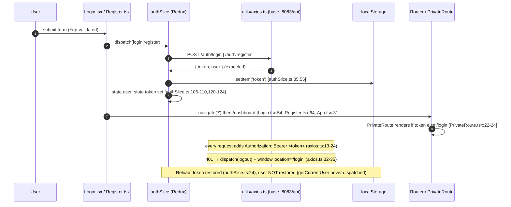
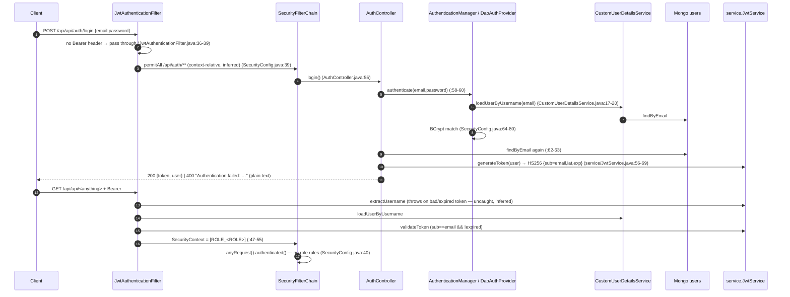

# EduNexus — Authentication Flow (Phase 3)

All steps are traced from source code. Steps marked *(inferred)* depend on framework semantics rather than an explicit line. No secret values are reproduced.

## 1. Frontend side (common to both backends)



| Step | Evidence |
|---|---|
| Login validation: email + password ≥ 8 | `Login.tsx:18-27` |
| Register validation: names, email, password ≥ 6, role ∈ student/instructor/admin | `Register.tsx:26-45` |
| Token persisted | `authSlice.ts:35,55` |
| Logout clears state and storage | `authSlice.ts:87-91`; triggered by `Layout.tsx:54-57` and `axios.ts:33` |
| Raw `fetch` calls send the token manually and have **no 401 handling** | `CourseDetail.tsx:68,138,144`; `CourseList.tsx:20`; `Profile.tsx:41` |

## 2. Spring Boot backend



**Weak points (confirmed unless marked):**
* The duplicate `jwtService` bean blocks startup *(inferred, high)*.
* Endpoints are at the doubled `/api/api` path.
* No `@Valid` on request bodies.
* A null role causes an NPE in `getAuthorities` (`User.java:53`).
* JWT exceptions in the filter are unhandled *(inferred)*.
* Two JWT key derivations exist (`security/JwtService.java:73-76` vs `service/JwtService.java:47-50`).
* The token carries no id or roles.
* No refresh or revocation.

## 3. Express backend

```mermaid
sequenceDiagram
    autonumber
    participant C as Client
    participant V as express-validator
    participant AC as controllers/auth.ts
    participant DB as Mongo users (Mongoose)
    participant MW as middleware/auth.ts
    participant CR as checkRole
    participant H as handler

    C->>V: POST /api/auth/register {email,password,firstName,lastName,role?}
    V-->>C: 400 {errors[]} if role ∉ {STUDENT,ADMIN} etc.   (routes/auth.ts:8-16)
    V->>AC: register   (controllers/auth.ts:6)
    AC->>DB: findOne(email); new User({..., roles:[role||'STUDENT']}); save (pre-save bcrypt)
    AC-->>C: 201 {token = sign({userId}, 24h), user{id,email,firstName,lastName,roles}}

    C->>MW: request + Bearer
    MW->>MW: jwt.verify → req.user = {userId, iat, exp}   (:23-31)
    MW-->>C: 401 {message} on missing/invalid
    MW->>CR: checkRole(['instructor','admin'])
    CR->>CR: req.user.roles is undefined → []   (:43)
    CR-->>C: 403 {message:'Access denied'}   — ALWAYS
    Note over CR,H: handler (with correct owner/TA checks) never reached
```

**Weak points:**
* Roles are missing from the token.
* Role casing and the missing `instructor` role.
* Self-ADMIN registration.
* A hard-coded fallback secret when `JWT_SECRET` is unset (`controllers/auth.ts:35,82`, `middleware/auth.ts:29`).
* `auth` does not confirm that the user still exists.
* No refresh or revocation.

## 4. Session lifecycle summary

| Event | Frontend | Spring | Express |
|---|---|---|---|
| Token lifetime | not checked | `jwt.expiration` (24 h) | `24h` |
| Token contents used by the server | — | `sub` = email → DB lookup per request | `userId` |
| Expiry handling | axios 401 → logout + redirect; fetch → none | filter throws *(inferred)* | 401 `Token is not valid` |
| Logout | client-side only | no endpoint | no endpoint |
| Session restore | **not implemented** | — | `GET /api/users/profile` available but unused |
