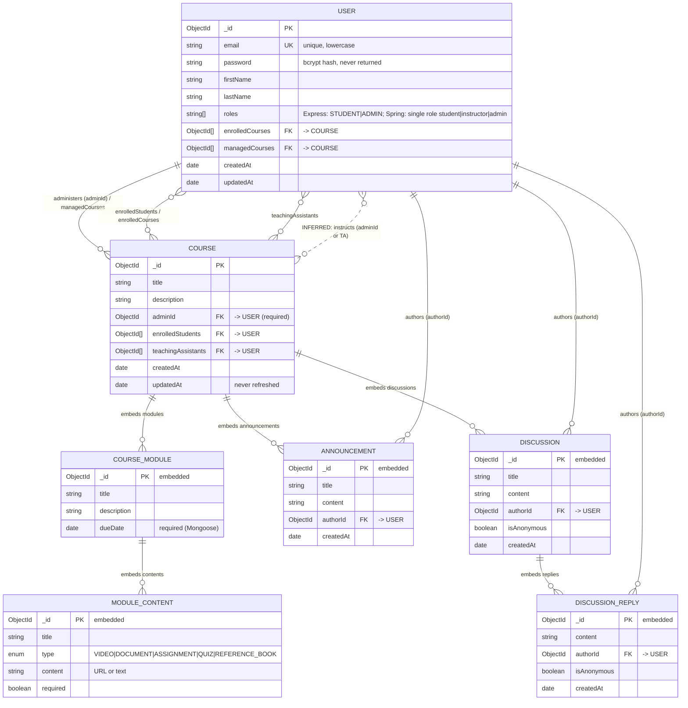

# EduNexus — Database Schema Reconstruction (Phase 3, Task 3)

**Source of truth:**
* Mongoose: `backend/src/models/User.ts`, `backend/src/models/Course.ts`.
* Spring Data: `backend/src/main/java/com/edunexus/model/User.java`, `.../model/Course.java`.
* Frontend type expectations: `frontend/src/types.ts`.
* README-only schema claims are listed separately (§6) and are **not** treated as implemented.

**Database:** MongoDB, database `edunexus`. Mongoose uses its connection URI. Spring hard-codes `MongoConfig.java:21-23`.

**Collections defined in code:** `users`, `courses` — exactly two. There is no separate collection for enrolments, modules, announcements, discussions, assignments or grades.

**Legend for relationships:**
* **[code]** — declared in a schema (`ref:` in Mongoose, or an id field whose name and usage in a controller make the target explicit).
* **[maintained]** — a controller writes both sides.
* **[inferred]** — a reasonable interpretation that no single line of code states; flagged explicitly.

---

## 1. `users` collection

| Field | Mongoose (`models/User.ts`) | Spring (`model/User.java`) | Frontend (`types.ts` / `authSlice.ts`) | Notes |
|---|---|---|---|---|
| id | `_id: ObjectId` (implicit) | `@Id String id` (`:29-30`) | `id: string` | Express exposes `_id`, except in hand-mapped auth/profile-update responses |
| email | `String`, required, **unique**, trim, lowercase (`:5-11`) | `String`, `@Indexed(unique=true)` (`:32-33`) | `email` | Spring index probably not auto-created (see backend report §2.4 S4) |
| password | `String`, required; bcrypt-hashed in `pre('save')` (`:12-15`, `:44-54`) | `String`, `@JsonIgnore`; BCrypt via `PasswordEncoder` (`:35-36`) | — | Never returned (Mongoose `select('-password')` in profile; Spring `@JsonIgnore`) |
| firstName | `String`, required, trim (`:16-20`) | `String` (`:37`) | `firstName` | |
| lastName | `String`, required, trim (`:21-25`) | `String` (`:38`) | `lastName` | |
| role(s) | `roles: [String enum ['STUDENT','ADMIN']]` (`:26-30`) | `role: String` (`:39`); enum `Role {student, instructor, admin}` (`:86-90`) only used for validation helper | `roles: ('student'\|'instructor'\|'admin')[]` (`types.ts:1,8`) | **Three incompatible representations** |
| enrolledCourses | `[ObjectId ref 'Course']` (`:31-34`) | `List<String>` (`:40`) | `enrolledCourses: string[]` | |
| managedCourses | `[ObjectId ref 'Course']` (`:35-38`) | `List<String>` (`:41`) | `managedCourses: string[]` (`authSlice.ts:12`) | |
| enabled | — | `boolean enabled = true` (`:42`) | — | Spring only; `isEnabled()` hard-coded `true` |
| createdAt | auto (`timestamps: true`, `:39-41`) | `@CreatedDate Long` (`:44-45`) | — | Date vs epoch-millis |
| updatedAt | auto | `@LastModifiedDate Long` (`:47-48`) | — | |
| __v | auto (Mongoose version key) | — | — | |

**Behaviour attached to the model:**
* Mongoose `comparePassword(candidate)` (`:57-63`).
* Spring `UserDetails` implementation: authorities `ROLE_<ROLE>`, username = email (`:50-84`).

---

## 2. `courses` collection

### 2.1 Course (root document)
| Field | Mongoose (`models/Course.ts:104-137`) | Spring (`model/Course.java:13-30`) | Frontend (`types.ts:12-26`) |
|---|---|---|---|
| id | `_id` | `@Id String id` | `id` |
| title | `String`, required | `String` | `title` |
| description | `String`, required | `String` | `description` |
| adminId | `ObjectId ref 'User'`, **required** (`:113-117`) | `String` | `adminId: string` |
| enrolledStudents | `[ObjectId ref 'User']` (`:118-121`) | `Set<String>` | `string[]` |
| teachingAssistants | `[ObjectId ref 'User']` (`:122-125`) | `Set<String>` | `string[]` |
| modules | `[courseModuleSchema]` | `List<CourseModule>` | `CourseModule[]` |
| announcements | `[announcementSchema]` | `List<Announcement>` | `Announcement[]` |
| discussions | `[discussionSchema]` | `List<Discussion>` | `Discussion[]` |
| createdAt | `Date`, default now (`:129-132`) | `LocalDateTime` (no auditing annotation) | — |
| updatedAt | `Date`, default now (`:133-136`); **never updated** | `LocalDateTime` | — |
| instructor, duration, level, price | — | — | present in `types.ts:16-19`, used only by the unrouted `CourseDetails.tsx` → **frontend-only, no backend storage** |

### 2.2 Embedded: CourseModule
| Field | Mongoose (`:23-37`) | Spring (`:32-39`) | Frontend (`types.ts:28-33`) |
|---|---|---|---|
| id | auto `_id` | `String id` (no generator) | `id` |
| title | `String`, required | `String` | `title` |
| description | `String`, required | `String` | `description` |
| contents | `[moduleContentSchema]` | `List<ModuleContent>` | `ModuleContent[]` |
| dueDate | `Date`, **required** | `LocalDateTime` | — (not rendered) |

### 2.3 Embedded: ModuleContent
| Field | Mongoose (`:3-21`) | Spring (`:41-56`) | Frontend (`types.ts:35-41`) |
|---|---|---|---|
| id | auto `_id` | `String id` | `id` |
| title | `String`, required | `String` | `title` |
| type | enum `VIDEO, DOCUMENT, ASSIGNMENT, QUIZ, REFERENCE_BOOK`, required | `enum ContentType` with the same five values | `'video' \| 'document' \| 'quiz' \| 'assignment'` — **lowercase, no `reference_book`** |
| content | `String`, required ("URL or text", comment at `Course.java:46`) | `String` | `content?` and `url?` (split) |
| required | `Boolean`, default true | `boolean` | — |

### 2.4 Embedded: Announcement
| Field | Mongoose (`:39-57`) | Spring (`:58-65`) | Frontend (`types.ts:43-49`) |
|---|---|---|---|
| id | auto `_id` | `String id` | `id` |
| title | required | `String` | `title` |
| content | required | `String` | `content` |
| authorId | `ObjectId ref 'User'`, required | `String authorId` | `author: string` (**name differs**) |
| createdAt | `Date`, default now | `LocalDateTime` | `createdAt: string` |

### 2.5 Embedded: Discussion
| Field | Mongoose (`:79-102`) | Spring (`:67-76`) | Frontend (`types.ts:51-58`) |
|---|---|---|---|
| id | auto `_id` | `String id` | `id` |
| title | required | `String` | `title` |
| content | required | `String` | `content` |
| authorId | `ObjectId ref 'User'`, required | `String` | `author` |
| isAnonymous | `Boolean`, default false | `boolean isAnonymous` | — |
| replies | `[discussionReplySchema]` | `List<DiscussionReply>` | `DiscussionReply[]` |
| createdAt | `Date`, default now | `LocalDateTime` | `createdAt` |

### 2.6 Embedded: DiscussionReply
| Field | Mongoose (`:59-77`) | Spring (`:78-85`) | Frontend (`types.ts:60-65`) |
|---|---|---|---|
| id | auto `_id` | `String id` | `id` |
| content | required | `String` | `content` |
| authorId | `ObjectId ref 'User'`, required | `String` | `author` |
| isAnonymous | default false | `boolean` | — |
| createdAt | default now | `LocalDateTime` | `createdAt` |

---

## 3. Relationships

| # | Relationship | Cardinality | Evidence | Class |
|---|---|---|---|---|
| R1 | Course **administered by** User (`Course.adminId → User`) | many courses : 1 user | `models/Course.ts:113-117` (`ref:'User'`, required); set to the requester in `controllers/course.ts:43` | [code] |
| R2 | User **manages** Courses (`User.managedCourses[] → Course`) | 1 : many | `models/User.ts:35-38`; pushed in `controllers/course.ts:50-52`; pulled in `:105-108` | [code] [maintained] — inverse of R1 |
| R3 | Course **has enrolled** Users (`Course.enrolledStudents[] → User`) | many : many | `models/Course.ts:118-121`; pushed in `controllers/course.ts:132-133` | [code] |
| R4 | User **enrolled in** Courses (`User.enrolledCourses[] → Course`) | many : many | `models/User.ts:31-34`; pushed in `controllers/course.ts:136-138` | [code] [maintained] — inverse of R3. **Not cleaned up on course delete.** |
| R5 | Course **assisted by** Users (`Course.teachingAssistants[] → User`) | many : many | `models/Course.ts:122-125`; read in `controllers/course.ts:71` | [code]. **No code ever adds a TA** except the mass-assignment `$set` in `updateCourse`. |
| R6 | Course **contains** Modules | 1 : many (embedded) | `models/Course.ts:126`, `Course.java:25` | [code] |
| R7 | Module **contains** Contents | 1 : many (embedded) | `models/Course.ts:32`, `Course.java:37` | [code] |
| R8 | Course **contains** Announcements | 1 : many (embedded) | `models/Course.ts:127` | [code] |
| R9 | Announcement **authored by** User | many : 1 | `models/Course.ts:48-52` (`ref:'User'`) | [code] |
| R10 | Course **contains** Discussions | 1 : many (embedded) | `models/Course.ts:128` | [code] |
| R11 | Discussion **authored by** User | many : 1 | `models/Course.ts:88-92` | [code] |
| R12 | Discussion **contains** Replies | 1 : many (embedded) | `models/Course.ts:97` | [code] |
| R13 | Reply **authored by** User | many : 1 | `models/Course.ts:64-68` | [code] |
| R14 | "Instructor of a course" = `adminId` user **or** any TA | — | Frontend `isInstructor = course.adminId === user.id \|\| teachingAssistants.includes(user.id)` (`frontend/src/pages/CourseDetail.tsx:117`); backend update permission uses the same pair (`controllers/course.ts:71`) | **[inferred]** — no entity named "instructor" exists; the README's `instructorId` is not in code |
| R15 | `adminId` user holds a global `instructor` or `admin` role | — | Implied by `checkRole(['instructor','admin'])` on create (`routes/course.ts:19`) | **[inferred]** — never enforced (E1) |

**Spring note:** Spring stores every reference as a plain `String` with no `@DBRef`/`@DocumentReference` (`Course.java:21-23`, `User.java:40-41`). The relationships are the same in meaning but are **not declared** at the mapping level, and no Spring code maintains them.

---

## 4. Conceptual ER diagram

Solid lines are relationships declared in code. Dotted lines (`..`) are **inferred**. Embedded subdocuments are modelled as composition (`||--o{` from the parent).

---

## 5. Data-integrity observations (from code)
1. **Bidirectional references are maintained non-atomically.** Enrolment saves the course, then updates the user (`controllers/course.ts:132-138`); a failure between the two leaves them inconsistent.
2. **Course deletion** removes `managedCourses` references but **not** `enrolledCourses` (`controllers/course.ts:104-108`).
3. `Course.updatedAt` is never refreshed (manual default, no `timestamps`).
4. Spring `Course.createdAt`/`updatedAt` are never set (no auditing annotations, no service code).
5. Embedded subdocument ids: Mongoose auto-generates `_id`. Spring declares `String id` but nothing generates it.
6. No indexes beyond `email` unique; no index on `adminId`, `enrolledStudents` or `teachingAssistants`, despite Spring finders that would query them (`CourseRepository.java:11-13`).

---

## 6. Entities required by frontend or README but missing from code

| Entity / field | Required by | Evidence | Status |
|---|---|---|---|
| Course `price`, `level`, `duration`, `instructor` (display name) | Frontend (dead page) | `frontend/src/pages/CourseDetails.tsx:46-56`; `types.ts:16-19` | **Missing** in both backends |
| Content `url` separate from `content` | Frontend types | `types.ts:39-40` | **Missing** (backend has a single `content` string) |
| Activity / audit log ("Recent Activity") | Frontend dashboard | `Dashboard.tsx:51-60` (static text) | **Missing** |
| `Assignment` collection {courseId, title, description, dueDate, totalMarks, submissions[]} | README only | `README.md:168-188` | **Missing** (README claim) |
| `Submission` {studentId, submissionDate, grade, feedback} | README only | `README.md:153-160,177-184` | **Missing** |
| Course `category` | README only | `README.md:139` | **Missing** |
| Course `instructorId` | README only | `README.md:138` | **Missing** (code uses `adminId`) |
| Module `order` | README only | `README.md:145` | **Missing** (array order is implicit) |
| Progress / completion per user per content | README "progress tracking" | `README.md:25,30` | **Missing** |
| Quiz questions / attempts | `ModuleContent.type = QUIZ` exists, no structure | `models/Course.ts:10` | **Missing** |
| File / media storage | Spring multipart limits configured | `application.properties:23-24` | **Missing** (no upload endpoint) |
| Enrolment metadata (date, status) | Implied by any progress or roster UI | — | **Missing** (enrolment is a bare id array) |
